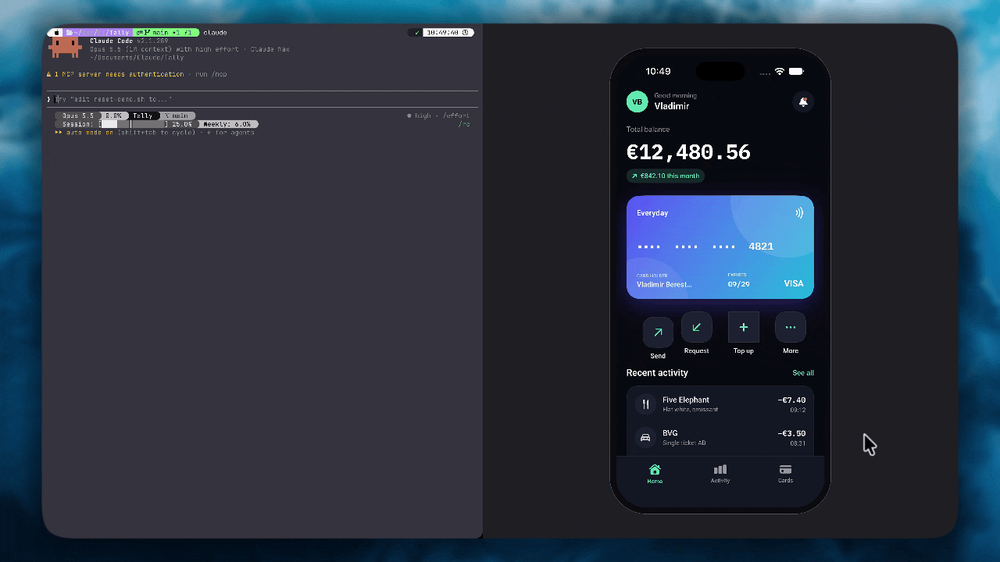
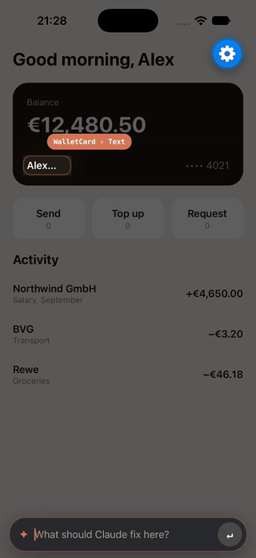
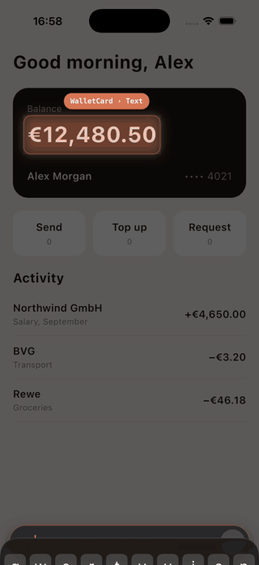

<!-- prettier-ignore -->
<div align="center">

# FixKit

**Long press anything in your iOS, React Native or Flutter app in the simulator, say what's wrong, and Claude Code or Codex fixes it.**


<br>


[](LICENSE)

[Overview](#overview) • [Getting started](#getting-started) • [Platforms](#pointing-at-the-right-code) • [How it works](#how-it-works) • [Try it on Tally](#try-it-on-tally) • [Troubleshooting](#troubleshooting)



[Watch the demo in full quality (MP4, 47 s)](docs/demo.mp4)

</div>

FixKit turns a long press in the iOS simulator into a prompt for your coding agent. The report carries your words, a screenshot with the element outlined, and the code behind the element: a SwiftUI file and line, a UIKit property, a React Native component or a Flutter widget. The agent fixes the code and puts the change on screen, and a banner in the app follows the report until the fix is live.

> [!TIP]
> To try FixKit without an app of your own, use **Tally**, the SwiftUI wallet in this repository with four seeded UI bugs. [It takes two commands](#try-it-on-tally).

## Overview

1. **Long press** an element and type what's wrong.
2. **The report lands** in your agent session as a prompt.
3. **The agent fixes the code** and puts it on screen: a rebuild for SwiftUI and UIKit, Fast Refresh for React Native, hot reload for Flutter.

FixKit has two halves:

- **In the app:** a debug-only library that sends reports. The **FixKit** Swift package for SwiftUI and UIKit, the **fixkit** npm package for React Native, the **fixkit** Dart package for Flutter.
- **In the agent:** the **fixkit** plugin, a mod with a Fix queue pane in Claude Code and hooks in Codex. Its local server, the receiver (`127.0.0.1:4747`), turns each report into a prompt.

### Features

- Works with SwiftUI, UIKit, React Native (Expo Go included) and Flutter apps, and with Claude Code or Codex.
- SwiftUI views report their own file and line with no markup; UIKit views are named after the property that holds them.
- The long press runs alongside the app's gestures: the pressed button doesn't fire, and scroll views keep scrolling.
- The composer and banners stay out of the screenshot the agent gets.
- The app's banner and the Fix queue pane follow each report from queued through fixing and rebuilding to live.
- Release builds leave FixKit out.

## Getting started

### Prerequisites

- [Claude Code](https://github.com/anthropics/claude-code) 2.1.287+ or [Codex CLI](https://github.com/openai/codex) 0.159+
- [Node.js](https://nodejs.org) 18.2+ (22+ for Flutter)
- Xcode with the iOS simulator; for SwiftUI and UIKit apps, Xcode 16.3+ and iOS 17+

> [!NOTE]
> FixKit works in the iOS simulator only: not on a device, and not on Android.

Recommended:

- [AXe](https://github.com/cameroncooke/AXe) adds what accessibility says about the pressed element to every report: its type, label, value and the labels beside it. Without AXe, reports still name the code the app finds itself. FixKit looks for AXe in `FIXKIT_AXE`, then on `PATH` (`brew install cameroncooke/axe/axe`), then in the copy bundled with XcodeBuildMCP run through `npx`.
- [XcodeBuildMCP](https://github.com/cameroncooke/XcodeBuildMCP) rebuilds and relaunches a SwiftUI or UIKit app in one call.

### 1. Install the plugin

Claude Code:

```bash
claude plugin marketplace add ostiums/fixkit
claude plugin install fixkit@fixkit
```

Codex:

```bash
codex plugin marketplace add ostiums/fixkit
codex plugin add fixkit@fixkit
```

### 2. Prepare the project

1. Add `.fixkit/` to `.gitignore`: reports and screenshots go there.
2. With Claude Code, let it read the screenshots without asking, in `.claude/settings.json`:

   ```json
   { "permissions": { "allow": ["Read(./.fixkit/**)"] } }
   ```

### 3. Add FixKit to the app

#### In a SwiftUI or UIKit app

In Xcode: File › Add Package Dependencies › `https://github.com/ostiums/fixkit`, rule **Branch: main**. Or in `Package.swift`:

```swift
.package(url: "https://github.com/ostiums/fixkit", branch: "main")
```

Then add one line:

```swift
import FixKit

// SwiftUI, on the root view
WindowGroup {
    ContentView()
        .fixKitHost()
}

// UIKit, on the main window once it is visible
window.makeKeyAndVisible()
window.fixKitHost()
```

<details>
<summary><b>Using Tuist</b></summary>

Add FixKit to every target with SwiftUI views, not only the app, and `import FixKit` in it; otherwise a view from that module is named where it is used, not where it is written. When more than one dynamic framework depends on FixKit, make it a framework too, so the app holds one copy:

```swift
// Tuist/Package.swift
#if TUIST
import ProjectDescription

let packageSettings = PackageSettings(productTypes: ["FixKit": .framework])
#endif
```

Left static, each framework holds its own copy, the views of all but one are named where they are used, and Tuist warns: "Target 'FixKit' has been linked from target 'A' and target 'B', it is a static product so may introduce unwanted side effects."

</details>

#### In a React Native app

```bash
npm install --save-dev fixkit
```

```tsx
import { FixKitHost } from 'fixkit'

export default function App() {
  return (
    <FixKitHost>
      <RootNavigator />
    </FixKitHost>
  )
}
```

No Xcode, Podfile or `app.json` changes. The run commands are under [React Native](#react-native).

#### In a Flutter app

```yaml
# pubspec.yaml
dependencies:
  fixkit:
    git:
      url: https://github.com/ostiums/fixkit.git
      path: flutter
```

```dart
import 'package:fixkit/fixkit.dart';

void main() => runApp(const FixKitHost(child: MyApp()));
```

### 4. Run it

With Claude Code:

1. Start `claude` in the project's root and run a debug build in the simulator.
2. Long press an element, type what's wrong, press Return.

The **Fix queue** pane lists reports and their status. It opens by itself in terminals 144+ columns wide, or with `/fix-queue`.

With Codex:

1. Start `codex` in the project's root and **trust the plugin's hooks** when asked (or later in `/hooks`).
2. **Send any message before the first long press**, or start with one: `codex "FixKit"`.
3. Run a debug build, long press, type, press Return.

> [!IMPORTANT]
> Untrusted hooks don't run, and FixKit starts with the Codex session's first turn. Until both happen, the app shows "FixKit is not listening". The other differences are under [Codex](#codex).

For React Native and Flutter, start the agent in the folder with `package.json` or `pubspec.yaml`: that is how the plugin knows which stack the app uses.

## Pointing at the right code

In SwiftUI and UIKit nothing has to be marked: SwiftUI views carry their own lines, UIKit views are named after their properties.

### SwiftUI

Every view reports the line its code starts on, the app's view around it and where that view is used:

```
[fix r1] TransactionRow › Text · Features/Home/TransactionRow.swift:29 · used at Features/Home/HomeView.swift:60 · StaticText "−€7.40" near "Coffee" · .fixkit/reports/r1.png
```

- **The innermost view wins:** a press on a row's amount names the amount's `Text`, a press between the row's labels names its `HStack`.
- **Backgrounds and overlays step aside:** shapes, colours and spacers lose to the content they sit behind or around.
- **"Used at" follows the code,** not where the view is drawn: a view moved by `.offset` or a header pinned over a row is reported where it is written.
- **`.fixable("name")` is optional.** It names the element (`card.holderName › Text`) and lets [scripted recordings](#scripted-recordings) press it. Names may carry data: `.fixable("transaction.amount.\(merchant)")`. The name goes to the view it is on and the views written inside it, up to the nearest view of the app's own: a `.fixable` on a `.background` or a `ZStack` layer names that layer, not the text over it.
- **`.fixScreen("Home")`** names the screen. With a `TabView`: `.fixScreen(selectedTab.rawValue)`.

The lines come from a `ViewBuilder.buildExpression` that FixKit adds in Debug builds: the compiler passes each view's file and line through it, and SwiftUI hands them back with the view's frame, the way Xcode Previews selects views.

Where it falls short:

- **A body with an explicit `return`** is named where it is used, and so is a view from another package.
- **A row scrolled entirely under a bar** drawn by the same SwiftUI hierarchy, such as a custom tab bar, can win over the bar where the bar has nothing of its own. Accessibility and the screenshot in the report show what was pressed.
- **The `MemberImportVisibility` upcoming feature** needs `import FixKit` in every file with views.
- **A builder that must return one concrete type** stops compiling in Debug; see [Troubleshooting](#troubleshooting).

> [!NOTE]
> To turn source lines off, depend on FixKit without its default `SourceLocations` trait: `traits: []` on the dependency in `Package.swift`, or the same in the package's traits in Xcode. An unmarked view is then named by accessibility (with AXe) and a `.fixable` view by its mark's line. The feature relies on SwiftUI's underscored API for Previews, so this is also the way out if an SDK drops it.

### UIKit

FixKit finds the property that holds the pressed view, in the view controller, a custom view or a cell:

```
[fix r1] ProfileViewController.nameLabel · UILabel "Alex Morgan" · .fixkit/reports/r1.png
```

- Outlets, `lazy var`s and arrays (`buttons[2]`) are found too; a press on a button's label names the button.
- The nearest owner wins: a label inside a custom card is named after the card's property.
- A view without a property is reported by class and screen: `UILabel "Alex Morgan" · ProfileViewController screen`.
- A press inside a sheet never names a view beneath it.

To get a file and line as well, mark the view:

```swift
let payButton = UIButton(configuration: .filled()).fixable("checkout.pay")
```

### React Native

The `fixkit` npm package is TypeScript with no native code, so it works in Expo Go and development builds. It needs React Native 0.80+ (React 19.1) with the New Architecture.



| Project | Command |
| --- | --- |
| Expo Go | `npx expo start --ios` |
| Expo development build | `npx expo run:ios` once, then `npx expo start --ios` |
| React Native CLI | `npx react-native run-ios` |

Keep Metro running: fixes go live through Fast Refresh, with no rebuild. Native changes (Podfile, `Info.plist`, config plugins) are rebuilt with the command above.

Reports name the components, the JSX line and where the component is used:

```
[fix r1] WalletCard › Text · src/WalletCard.tsx:11 · used at App.tsx:15 · StaticText "Alex Morgan" · .fixkit/reports/r1.png
```

- With AXe, `testID`s appear as `#id`.
- **The pressed button stays still:** `Pressable`, `Touchable*`, `Button` and pressable `Text` don't fire while FixKit holds a press. FixKit wraps React Native's private `Pressability` for that, so Metro warns once about a deep import. Gesture Handler buttons aren't held.
- **Lines may be a few off** after Fast Refresh changes a file, until the next reload.
- **Not covered yet:** native `Modal`s and natively presented screens, nested `<FixKitHost>`, Android.

Try it on the example app:

```bash
cd react-native/example && npm install && npx expo start --ios
claude --plugin-dir ../../mod    # in the same folder
```

### Flutter

The `fixkit` Dart package is Dart only, with no native code and no dependency beside the Flutter SDK, so nothing changes in the Podfile or the Xcode project. It needs Flutter 3.35+.



Run the app with `flutter run` in the iOS simulator, from a terminal, VS Code or Android Studio.

Saving a file does not hot reload a Flutter app, so the agent asks for it: in Claude Code with the mod's `hot_reload` tool, in Codex with a POST to the receiver's `/reload`. Both go through the VM service `flutter run` serves, the one DevTools' reload button calls. A compile error comes back to the agent; for a change hot reload can't apply (`initState`, globals, `main`), the agent hot restarts the app instead.

Reports name the app's widget around the pressed one, the line of its constructor call and where that widget is used:

```
[fix r1] WalletCard › Text · lib/wallet_card.dart:20 · used at lib/main.dart:34 · StaticText "€12,480.50" · .fixkit/reports/r1.png
```

- **Widgets from Flutter and pub.dev packages are skipped** for the app's own widget around them.
- **The pressed button stays still:** FixKit's long press wins Flutter's gesture arena at 450 ms, before a widget's own 500 ms long press, so the widget under the finger neither taps nor long-presses. An app's long press shorter than 450 ms wins over FixKit's.
- **Lines stay current:** a hot reload rebuilds the widgets from the new code.
- **Not covered yet:** a widget built in a helper method points into that method, not at its caller; Android.

Try it on the example app:

```bash
cd flutter/example
claude --plugin-dir ../../mod    # in this folder
flutter run                      # in a second terminal, with the iOS simulator booted
```

## Codex

With Codex, hooks start the receiver and report progress in place of the mod. Compared with Claude Code:

- **No pane.** Progress shows only in the app's banners, which name Codex: "Sent to Codex", "Fixed by Codex". The log is in `$TMPDIR/fixkit-codex.log`.
- **Only in app projects:** a folder, or one above it up to the git root, with an Xcode project or workspace, a `Package.swift`, a React Native `package.json` or a Flutter `pubspec.yaml`. Elsewhere FixKit does nothing.
- **Needs Codex's shared app-server**, the default. Sessions started with `codex --no-daemon` get no reports.
- **Ending the session stops FixKit.** Reports already queued run when you resume, but without a banner.
- **Flutter reloads need network access.** Codex's default sandbox blocks the POST to `/reload`, even to `127.0.0.1`: approve the command when Codex asks, or allow it for the session with `codex -c sandbox_workspace_write.network_access=true`.

## How it works

```
app (FixKit) ──POST /report──▶ receiver (node, 127.0.0.1:4747) ──AXe──▶ simulator
      ▲                               │
      │ GET /status, POST /launched   ▼
      └────────── statuses ◀── Claude Code mod  or  Codex hooks
```

- **The long press** takes 0.5 s in SwiftUI and UIKit, 450 ms in React Native and Flutter. It runs alongside the app's gestures. In SwiftUI and UIKit, at the default Haptic Touch speed, it also wins over a view's `.contextMenu`: the menu is cancelled before it opens.
- **The composer and banners** stay out of screenshots. In SwiftUI and UIKit they live in a separate window above the app and cover sheets; in React Native and Flutter they are drawn over the app and hidden before the screenshot.
- **The receiver** asks AXe for the deepest element under the touch and saves the accessibility tree to `.fixkit/reports/<id>.ax.json`.
- **In Claude Code**, the mod submits the report as a prompt and tracks its turn. **In Codex**, the receiver queues the prompt with `codex queue`, and hooks report the turn's progress.
- **"Live"** means the app launched or reloaded while the agent worked: a relaunch from XcodeBuildMCP, `xcodebuild` or Xcode's Run, a Fast Refresh, a Flutter hot reload or restart.
- **One session at a time:** the newest session takes port 4747.
- **Release builds** leave FixKit out: the Swift package compiles to nothing whatever flags the app sets, and `FixKitHost` in React Native and Flutter returns the app untouched outside debug mode and off iOS.

## Try it on Tally

[`Tally/`](Tally) is a SwiftUI wallet with four seeded UI bugs. From the repository's root:

```bash
./scripts/reset-demo.sh          # restores the bugs, builds and launches Tally
claude --plugin-dir ./mod        # the plugin from this checkout
```

| Where | Long press | Say |
| --- | --- | --- |
| Home | the Send button | button is shifted |
| Home | the Top up button | corners don't match the others |
| Home or Cards | the card holder name | name is cut off |
| Home or Activity | a green-category amount, such as the salary | income should be green |

The bugs come from the git tag `demo-start`, so `reset-demo.sh` brings them back before each run. The scripts use the iPhone 18 Pro simulator; set `SIMULATOR` for another.

## Scripted recordings

SwiftUI and UIKit apps can play reports from a script, for screen recordings. Enable it:

```bash
xcrun simctl spawn booted defaults write <bundle id> FixKitDirector -bool YES
```

Then run a server on `127.0.0.1:4748` that answers `GET /next` with one step as JSON, status 200:

```json
{"press": "card.holderName", "text": "The name is cut off"}
{"at": [321, 686], "text": "Income should be green"}
{"scroll": 260}
{"defaults": {"selectedTab": "Activity"}}
```

`press` targets a `.fixable` name, `at` a point. `defaults` stores string values for the next launch.

> [!WARNING]
> FixKit asks for the next step at launch and after each one, and any status other than 200 makes it ask again at once. Stop the server when the script is done.

## Troubleshooting

**The app shows "FixKit is not listening".** No agent session holds the receiver. Start `claude` or `codex` in the project's root; in Codex, trust the plugin's hooks and send a first message. A session started with `codex --no-daemon` never receives reports.

**A SwiftUI builder stops compiling in Debug** with an error like this one:

```
cannot convert return expression of type 'ModifiedContent<Text, FixMarkModifier>' to return type 'Text'
```

Every view in a builder comes back wrapped, so a builder that must return one concrete type, such as `@ViewBuilder title: () -> Text` or `@ViewBuilder var label: Text`, no longer type-checks. Return `some View` there, drop `@ViewBuilder` where a single view is returned, or [turn source lines off](#swiftui). A builder whose result must be `Sendable` gets a warning before iOS 26.

**A SwiftUI view is named where it is used, not where it is written.** Its body has an explicit `return`, or it comes from another module. In a Tuist or multi-module project, add FixKit and `import FixKit` to that module too (see [Using Tuist](#in-a-swiftui-or-uikit-app)).

**React Native reports come without a screenshot.** With several simulators of the same iOS version booted, the receiver can't tell which one runs the app. Boot one simulator per iOS version.

**A React Native or Flutter app is treated as a native one,** or Codex doesn't start FixKit. Start the agent in the folder with `package.json` or `pubspec.yaml`, not above it.

## Development

```bash
./scripts/test.sh
```

It runs every check: plugin validation, the mod, receiver and Codex tests, the React Native tests (Node.js 22.18+), the Flutter package's tests and analysis (when `flutter` is installed), the Swift package's tests and a build without its default trait, and Tally's Debug and Release builds.

| Folder | Contents |
| --- | --- |
| [`Sources/FixKit/`](Sources/FixKit), [`Tests/`](Tests) | The Swift package and its tests |
| [`mod/`](mod) | The Claude Code mod and Codex hooks, with the receiver in `mod/server/` |
| [`react-native/`](react-native) | The `fixkit` npm package, with an Expo example in `example/` |
| [`flutter/`](flutter) | The `fixkit` Dart package, with an example app in `example/` |
| [`Tally/`](Tally) | The SwiftUI demo app |
| [`scripts/`](scripts) | `test.sh` and `reset-demo.sh` |
